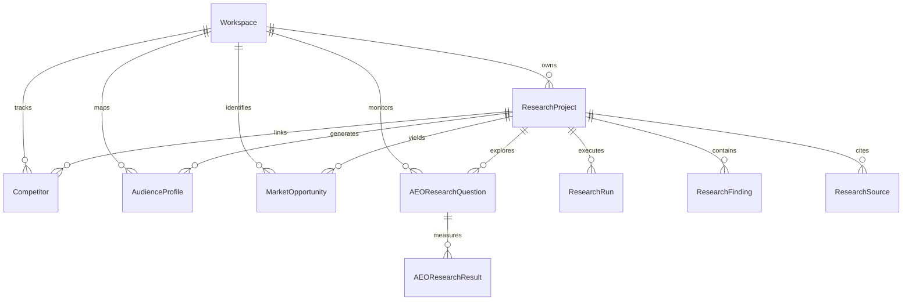
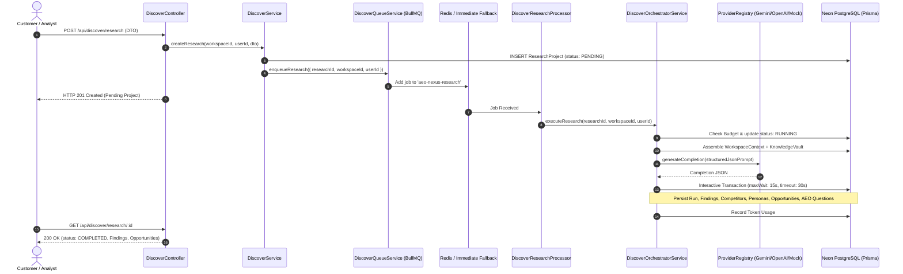

# AEO Nexus — Discover Module Architecture

## 1. Overview & Core Philosophy

The **Discover Module** (`apps/customer-web/src/app/discover/` and `apps/api/src/discover/`) forms the AI-powered business research and opportunity intelligence foundation of AEO Nexus. It allows businesses and agency teams to conduct rigorous market analysis, extract competitive intelligence, map customer personas, identify high-conviction market opportunities with concrete validation experiments, and benchmark Answer Engine Optimization (AEO) visibility across major LLMs (Google Gemini, OpenAI, Claude).

The Discover module is built directly upon the Phase 5 AI Foundation, reusing provider adapters, workspace context injection, knowledge retrieval, and usage metering.

---

## 2. Evidence Standards & Data Integrity Principles

A fundamental requirement of the Discover module is complete transparency between verified facts, AI-generated deductions, user-supplied data, and unverified assumptions.

```
+-----------------------------------------------------------------------------------+
|                            EVIDENCE TAXONOMY MATRIX                                |
+-----------------------+----------------------+--------------------+---------------+
| Classification        | Source Origin        | UI Badge           | Integrity Tag |
+-----------------------+----------------------+--------------------+---------------+
| VERIFIED_SOURCE       | Crawled/Verified URL | Success (Green)    | [Verified]    |
| AI_ANALYSIS           | Model Synthesis      | Primary (Indigo)   | [AI Analysis] |
| USER_INPUT            | Workspace Analyst    | Secondary (Slate)  | [User Input]  |
| UNVERIFIED_ASSUMPTION | Model Hypothesis     | Warning (Amber)    | [Assumption]  |
+-----------------------+----------------------+--------------------+---------------+
```

### Strict Integrity Guardrails
1. **No Financial or Metric Fabrication**: AI engines never invent competitor revenues, traffic figures, or exact customer counts. If accurate verified data is unavailable, the model records the field as `null` or explicit estimates flagged with `confidenceLevel: LOW`.
2. **Synthetic ICP Attribution**: Any persona synthesized by the research engine is permanently flagged with `isAiGenerated: true` to prevent confusing synthetic model profiles with surveyed human customer panels.
3. **AEO Measurement Demarcation**: Any simulated answer engine visibility diagnostic is tagged with `isActualMeasurement: false` unless verified through live API response logs.

---

## 3. Data Architecture (Neon Serverless PostgreSQL + Prisma)

The Discover module schema introduces 9 core relational models and 4 structured enums.



### Prisma Enums
- **`ResearchStatus`**: `PENDING`, `RUNNING`, `COMPLETED`, `FAILED`, `CANCELLED`
- **`EvidenceType`**: `VERIFIED_SOURCE`, `AI_ANALYSIS`, `USER_INPUT`, `UNVERIFIED_ASSUMPTION`
- **`ConfidenceLevel`**: `HIGH`, `MEDIUM`, `LOW`
- **`SourceType`**: `INDUSTRY_REPORT`, `COMPETITOR_WEBSITE`, `ACADEMIC_STUDY`, `NEWS_ARTICLE`, `USER_KNOWLEDGE_BASE`, `AI_SYNTHESIS`

---

## 4. Asynchronous Pipeline & BullMQ Architecture

Research dossiers require deep context assembly, bounded knowledge retrieval, LLM synthesis, and structured JSON parsing. These workloads are decoupled from HTTP request cycles via BullMQ.



---

## 5. Security & Multi-Tenancy Perimeters

1. **Strict Multi-Tenant Isolation**: Every database read, mutation, and aggregation is filtered by `workspaceId`. A tenant querying foreign research projects receives an immediate `404 Not Found` or `403 Forbidden`.
2. **Hard Monthly Token & Cost Caps**: Before initiating research synthesis, `AiUsageService.checkBudgetOrThrow(workspaceId)` verifies that the workspace has not exceeded its monthly token or dollar budget. If exceeded, the run is blocked immediately.
3. **Interactive Transaction Safety**: Neon hosted serverless PostgreSQL connections over WAN enforce connection limits. The orchestrator bounds interactive transactions with `maxWait: 15000` and `timeout: 30000`, running queries sequentially to avoid exhausting compute pools.

