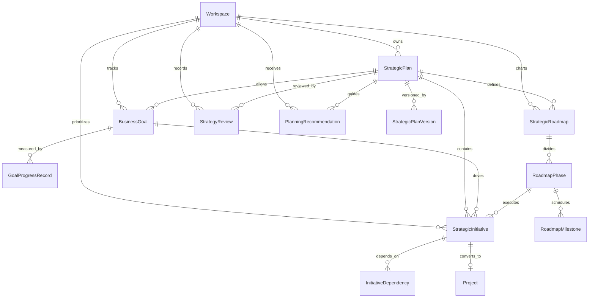
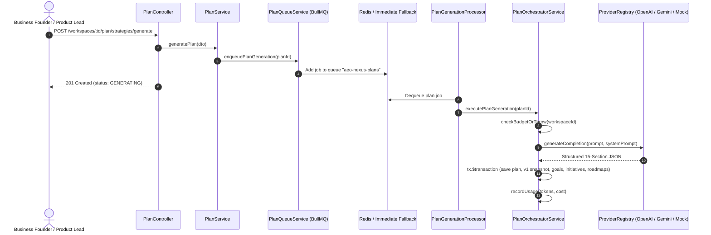
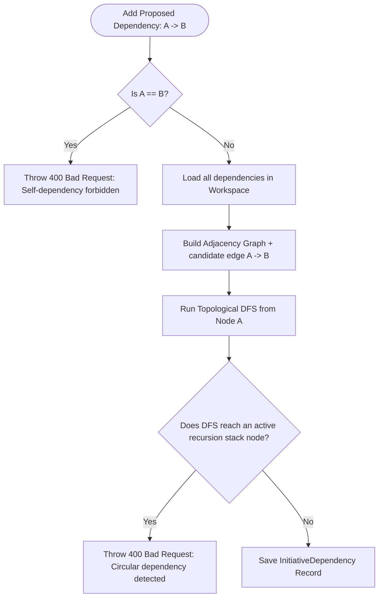
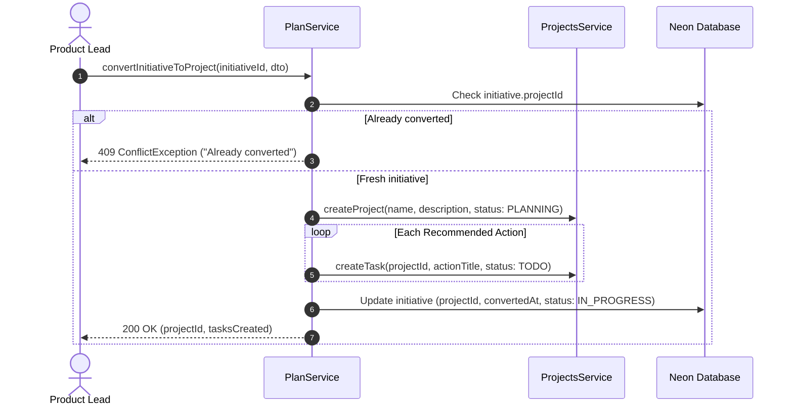

# AEO Nexus — Plan Module Architecture

## 1. Overview & Core Philosophy

The **Plan Module** (`apps/customer-web/src/app/plan/` and `apps/api/src/plan/`) forms the strategic business planning and execution roadmap engine of AEO Nexus. It connects market insights from the **Discover** module with actionable, measurable execution paths:

$$\text{Discover (Research \& Opportunities)} \longrightarrow \mathbf{Plan\ (Strategy,\ Roadmaps,\ Goals)} \longrightarrow \text{Build\ (Digital\ Products)}$$

The Plan module transforms high-level opportunity intelligence into rigorous, 15-section strategic plans, multi-phase execution roadmaps, quantitative/qualitative key performance indicators (KPIs), and prioritized initiatives. Approved strategic initiatives can be seamlessly converted into active Phase 4 engineering projects and task deliverables.

---

## 2. Evidence Standards & Taxonomy Matrix

Consistent with the platform-wide data integrity standards established in Phase 6A, every objective, initiative, and recommendation within the Plan module carries explicit provenance:

| Classification | Source Origin | UI Badge | Integrity Guarantee |
| :--- | :--- | :--- | :--- |
| **`VERIFIED_SOURCE`** | Grounded in workspace knowledge base or verified citations | Green (`Verified`) | Grounded in indexed documentation |
| **`AI_ANALYSIS`** | Derived through AI synthesis and strategic heuristics | Blue (`AI Analysis`) | Calculated from workspace context & benchmarks |
| **`USER_INPUT`** | Provided directly by workspace users/founders | Purple (`User Input`) | Explicit human input |
| **`UNVERIFIED_ASSUMPTION`** | Model hypotheses requiring live market validation | Amber (`Assumption`) | Requires explicit validation experiments |

### Data Integrity Guardrails
1. **Zero Financial or Metric Fabrication**: The engine never fabricates artificial financial valuations, guarantees, or baseless ROI claims.
2. **Explicit Evidence Attribution**: Every strategic initiative displays its classification to ensure human decision-makers know whether an item is based on published facts or predictive assumptions.
3. **Idempotent Traceability**: When an initiative is converted into a project, its unique `projectId` link is locked, preventing duplicate project creation.

---

## 3. Data Architecture (Neon Serverless PostgreSQL + Prisma)

The Plan module introduces 11 relational models and 8 structured enums, fully integrated into the Neon serverless PostgreSQL database.

### Prisma Enums
- **`PlanStatus`**: `DRAFT`, `GENERATING`, `READY_FOR_REVIEW`, `APPROVED`, `ACTIVE`, `COMPLETED`, `ARCHIVED`
- **`GoalCategory`**: `REVENUE`, `CUSTOMER_ACQUISITION`, `CUSTOMER_RETENTION`, `WEBSITE_TRAFFIC`, `BRAND_AWARENESS`, `AEO_VISIBILITY`, `PRODUCT_LAUNCH`, `OPERATIONAL_EFFICIENCY`
- **`GoalStatus`**: `NOT_STARTED`, `IN_PROGRESS`, `ON_TRACK`, `AT_RISK`, `BEHIND`, `ACHIEVED`, `CANCELLED`
- **`GoalPriority`**: `LOW`, `MEDIUM`, `HIGH`, `CRITICAL`
- **`InitiativePriority`**: `LOW`, `MEDIUM`, `HIGH`, `CRITICAL`
- **`InitiativeStatus`**: `PROPOSED`, `PLANNED`, `IN_PROGRESS`, `COMPLETED`, `ON_HOLD`, `CANCELLED`
- **`ReviewPeriod`**: `WEEKLY`, `MONTHLY`, `QUARTERLY`, `ANNUALLY`
- **`ReviewStatus`**: `DRAFT`, `IN_PROGRESS`, `COMPLETED`

---

## 4. Asynchronous Pipeline & BullMQ Architecture

Strategic plan generation utilizes BullMQ with graceful fallback to in-process asynchronous execution when Redis is unavailable:

---

## 5. Topological Cycle Detection in Strategic Dependencies

To prevent deadlock and contradictory priorities in strategic roadmaps, the dependency engine enforces a directed acyclic graph (DAG) using a Depth-First Search (DFS) cycle detection algorithm before any dependency edge is committed:

---

## 6. Initiative-to-Project Conversion Flow

Strategic initiatives bridge the gap between executive strategy and tactical engineering deliverables:

---

## 7. Customer Web Experience (10 Routes)

The customer portal (`apps/customer-web`) implements 10 dedicated routes:

1. **`/plan`**: Central Executive Dashboard displaying KPIs, active plans, prioritized initiatives, and urgent milestone alerts.
2. **`/plan/strategies`**: Strategic plans catalog with status filtering and search.
3. **`/plan/strategies/new`**: Guided planning wizard connecting Discover intelligence and target parameters.
4. **`/plan/strategies/[planId]`**: 15-section strategic workspace, evidence taxonomy, version history drawer, and approval controls.
5. **`/plan/roadmaps`**: Multi-phase visual roadmaps with Phase order and timeline milestones.
6. **`/plan/goals`**: Quantitative and qualitative KPI trackers with progress logging modals.
7. **`/plan/priorities`**: Prioritized initiatives with Impact/Effort metrics and "Convert to Project" action.
8. **`/plan/milestones`**: Granular milestone tracking with overdue alerts and completion verification.
9. **`/plan/reviews`**: Strategy review conductor and historical governance decisions.
10. **`/plan/reports`**: Printable/exportable executive plan briefs.
